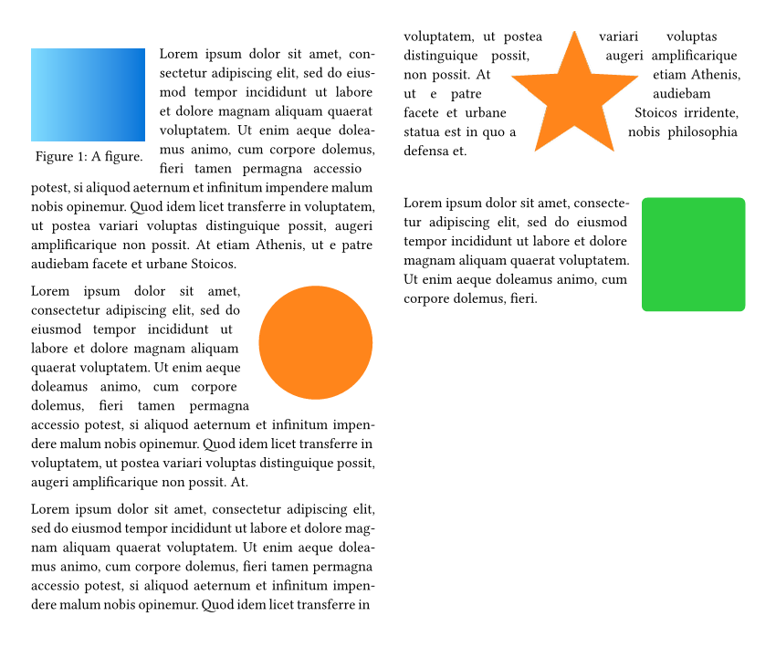
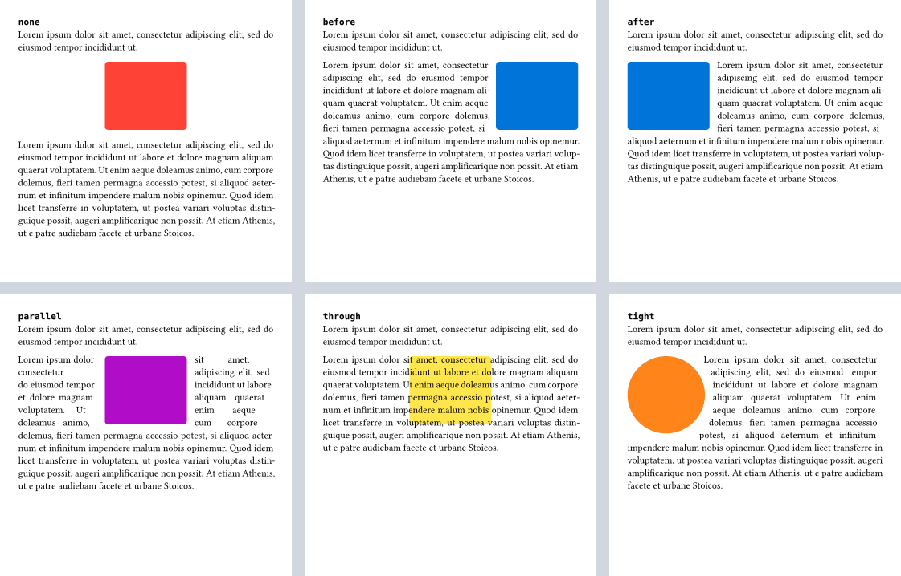

# runaround

Flow text around figures, images and shapes — like LaTeX's `wrapfigure`, with
the wrap modes of LibreOffice Writer. You mark the *object*; runaround finds
the text that follows it and decides where to break lines and pages.

<picture>
  <source media="(prefers-color-scheme: dark)" srcset="docs/overview-dark.png">
  
</picture>

## Usage

Add the show rule once, then wrap the objects that text should flow around.
Everything after the object — paragraphs, lists, headings — flows around it
automatically and continues at full width below it.

```typ
#import "@preview/runaround:0.1.0": runaround, wrap
#show: runaround

#wrap(mode: "after")[
  #figure(rect(width: 3cm, height: 2cm, fill: aqua), caption: [A box.]) <box>
]
As @box shows, the text continues to the right of the figure.
#lorem(60)
```

Place `#show: runaround` after your template's show rule, so that runaround
sees your content as you wrote it.

## Modes

<picture>
  <source media="(prefers-color-scheme: dark)" srcset="docs/modes-dark.png">
  
</picture>

| `mode` | Object position | Text |
| --- | --- | --- |
| `"none"` (default) | centre | above and below only |
| `"before"` | right | left of the object |
| `"after"` | left | right of the object |
| `"parallel"` | centre | both sides, read line by line across the object |
| `"through"` | centre | unaffected; the object is drawn behind the text (or in front with `behind: false`) |
| `"tight"` | left | follows the object's contour: on the right for `left`, the left for `right`, both sides for `center` |

The position can be changed with `align` (`left`, `center`, `right`, `start`
or `end`) and shifted with `dx`.

## Options

`wrap(body, ..options)` takes these options. Each defaults to the value given to
`runaround`, so document-wide defaults go into the show rule:

```typ
#import "@preview/runaround:0.1.0": runaround, wrap
#show: runaround.with(mode: "after", gap: 1.2em, min-width: 8em)

#wrap(rect(width: 3cm, height: 3cm))
#lorem(50)
```

| Option | Default | Meaning |
| --- | --- | --- |
| `mode` | `"none"` | see [Modes](#modes) |
| `align` | depends on the mode | horizontal position of the object |
| `dx` | `0pt` | extra horizontal offset |
| `gap` | `1em` | space between object and text; a length or `(x: .., y: ..)` |
| `min-width` | `6em` | a side narrower than this gets no text (avoids very narrow columns) |
| `width` | `auto` | width of the object; figure captions wrap to the width of the figure body |
| `contour` | `auto` | the shape for `"tight"`, see [Contours](#contours) |
| `behind` | `true` | for `"through"`: draw the object behind the text |

## Wrapping elements automatically

`auto-wrap` wraps elements without marking each one. Map an element name to a
mode, a dictionary of options, or a function that returns either (or `none` to
leave an element alone):

```typ
#import "@preview/runaround:0.1.0": runaround, wrap
#show: runaround.with(auto-wrap: (figure: "after"))

#figure(image("docs/star.png", width: 2.5cm), caption: [Wrapped automatically.])
#lorem(40)

#wrap(mode: "none")[#figure(rect(width: 3cm, height: 2cm), caption: [Not this one.])]
```

A function receives the element as you wrote it (fields you did not set are
`auto`), for example `figure: it => if it.body.func() == image { "after" }`.

Supported names: `figure`, `image`, `table`, `rect`, `square`, `circle`,
`ellipse`, `polygon` and `block`. Floating figures (`placement` other than
`none`) are never wrapped. The option is called `auto-wrap` because `auto` is
a reserved word in Typst.

## Contours

In mode `"tight"`, the text follows the shape of the object:

- circles, ellipses, polygons and rectangles with rounded corners are
  recognised automatically;
- images with transparency (PNG, GIF, WebP) are traced from their alpha channel.
  Pass the file as a `path`, so that runaround can read it:
  `image(path("cat.png"))`;
- figures use the contour of their body plus the caption area.

`contour` can also be set explicitly: `none` (the bounding box), a shape that is
stretched over the object (`circle()`, `polygon(..)`), a list of points such as
`((0%, 0%), (100%, 50%), (0%, 100%))`, image `bytes` or a `path`, or a function
from the relative height (0 at the top, 1 at the bottom) to the horizontal
extent:

```typ
#import "@preview/runaround:0.1.0": runaround, wrap
#show: runaround

#wrap(mode: "tight", align: right, contour: y => (60% * (1 - y), 100%))[
  #rect(width: 3cm, height: 3cm, fill: gradient.linear(white, purple))
]
#lorem(60)
```

## Line and page breaks

- A paragraph that continues below the object is split where a line ends anyway;
  the split is invisible.
- If an object does not fit on the rest of the page, the text first fills that
  space at full width and the object moves to the top of the next page.
- Headings, lists, equations and code next to an object stay intact; lists break
  between items, and a heading never stays alone at the bottom of the space
  beside an object.

## Performance

runaround measures only the text that sits beside an object, and splits
paragraphs with a few measurements of bounded size instead of trying one word
after another. Text elsewhere costs nothing extra. On a generated document with
60 wrapped objects (32 pages), compilation took about 0.5 s and 50 MiB of peak
memory, and the cost grows linearly with the number of objects. The test suite
enforces time and memory budgets.

## Limitations

- `#show: runaround` is required: Typst does not allow packages to add options
  to built-in elements.
- Objects created inside `context` or by your own show rules are not found; use
  `auto-wrap` instead.
- In modes `"parallel"` and `"tight"`, every line is laid out on its own, so
  word spacing is a little less even than in a normal paragraph.
- A block-level `#set` rule between an object and its text ends the text beside
  the object.
- Raster contours need the image as a `path` or `bytes`; a plain string path
  cannot be read by a package.
- In the experimental HTML export, objects become CSS floats (`before`,
  `after`, one-sided `tight`); other modes show the object as a block.

## License

MIT, see [LICENSE](LICENSE).
